<div align="center">

# bentwire-classics

**The classic Microsoft Agent and Office Assistant characters for [bentwire](https://github.com/mschabhuettl/bentwire).**

[](https://github.com/mschabhuettl/bentwire-classics/releases/latest)
[](https://github.com/mschabhuettl/bentwire)
[](#licence)

</div>

> **Microsoft, please don't sue me ❤️**
>
> bentwire is a private, non-commercial fun project made out of affection for Clippy and
> his friends. I make no money from it and have no commercial interest in it. bentwire is
> not affiliated with or endorsed by Microsoft. Microsoft Agent, Microsoft Office, Clippit
> and the other character names are trademarks of Microsoft Corporation, and the
> characters in this pack are Microsoft's work. If you are Microsoft and want something
> removed, please [open an issue](https://github.com/mschabhuettl/bentwire-classics/issues)
> or contact me, and I will take it down.

<div align="center">


</div>

The `classics` character pack for [bentwire](https://github.com/mschabhuettl/bentwire):
61 Microsoft Agent and Office Assistant characters converted into the bentwire
character format, plus the Office XP balloon theme (`balloon-themes/office`, from
`OBALLOON.DLL` 10.0.2607). Everything here is generated by `regenerate.sh` from the original
files.

## Contents

- [Gallery](#gallery)
- [Licence](#licence)
- [Characters](#characters)
- [Install](#install)
- [Regenerate](#regenerate)
- [Screenshots and GIFs](#screenshots-and-gifs)

## Gallery

Every character in its rest pose, at 1x (shown scaled to one height). Each cell gives the
name, the id, the family of the character format (`agent` or `office97`) and the source
product. The images are made from the `.bwc` files by
bentwire's `scripts/gallery.sh` and are reproducible byte for byte.

<table>
<tr>
<td align="center" valign="bottom">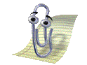<br><b>Clippit</b><br><code>clippit</code><br><sub>agent, Microsoft Agent 2.0</sub></td>
<td align="center" valign="bottom"><br><b>Courtney</b><br><code>courtney</code><br><sub>agent, Microsoft Agent 2.0</sub></td>
<td align="center" valign="bottom"><br><b>The Dot</b><br><code>dot</code><br><sub>agent, Microsoft Agent 2.0</sub></td>
<td align="center" valign="bottom">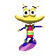<br><b>Earl</b><br><code>earl</code><br><sub>agent, Microsoft Agent 2.0</sub></td>
<td align="center" valign="bottom">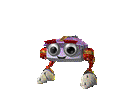<br><b>F1</b><br><code>f1</code><br><sub>agent, Microsoft Agent 2.0</sub></td>
</tr>
<tr>
<td align="center" valign="bottom">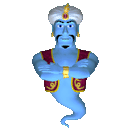<br><b>Genie</b><br><code>genie</code><br><sub>agent, Microsoft Agent 2.0</sub></td>
<td align="center" valign="bottom">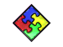<br><b>Office Logo</b><br><code>logo</code><br><sub>agent, Microsoft Agent 2.0</sub></td>
<td align="center" valign="bottom">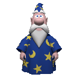<br><b>Merlin</b><br><code>merlin</code><br><sub>agent, Microsoft Agent 2.0</sub></td>
<td align="center" valign="bottom">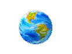<br><b>Mother Nature</b><br><code>mnature</code><br><sub>agent, Microsoft Agent 2.0</sub></td>
<td align="center" valign="bottom">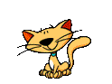<br><b>Links</b><br><code>offcat</code><br><sub>agent, Microsoft Agent 2.0</sub></td>
</tr>
<tr>
<td align="center" valign="bottom">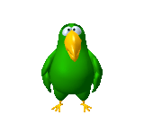<br><b>Peedy</b><br><code>peedy</code><br><sub>agent, Microsoft Agent 2.0</sub></td>
<td align="center" valign="bottom"><br><b>Qmark</b><br><code>qmark</code><br><sub>agent, Microsoft Agent 2.0</sub></td>
<td align="center" valign="bottom">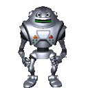<br><b>Robby</b><br><code>robby</code><br><sub>agent, Microsoft Agent 2.0</sub></td>
<td align="center" valign="bottom">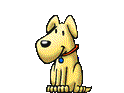<br><b>Rocky</b><br><code>rocky</code><br><sub>agent, Microsoft Agent 2.0</sub></td>
<td align="center" valign="bottom">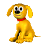<br><b>Rover</b><br><code>rover</code><br><sub>agent, Microsoft Agent 2.0</sub></td>
</tr>
<tr>
<td align="center" valign="bottom"><br><b>Merlin</b><br><code>merlin-15</code><br><sub>agent, Microsoft Agent 1.5</sub></td>
<td align="center" valign="bottom">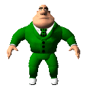<br><b>Al</b><br><code>al-15</code><br><sub>agent, Microsoft Agent 1.5 (third-party)</sub></td>
<td align="center" valign="bottom">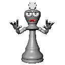<br><b>Checkmate</b><br><code>check-15</code><br><sub>agent, Microsoft Agent 1.5 (third-party)</sub></td>
<td align="center" valign="bottom">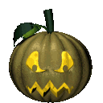<br><b>Gourdy</b><br><code>gourdy-15</code><br><sub>agent, Microsoft Agent 1.5 (third-party)</sub></td>
<td align="center" valign="bottom">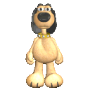<br><b>Max</b><br><code>max-15</code><br><sub>agent, Microsoft Agent 1.5 (third-party)</sub></td>
</tr>
<tr>
<td align="center" valign="bottom">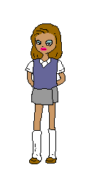<br><b>Miku</b><br><code>miku-15</code><br><sub>agent, Microsoft Agent 1.5 (third-party)</sub></td>
<td align="center" valign="bottom">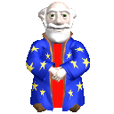<br><b>Ozzar</b><br><code>ozzar-15</code><br><sub>agent, Microsoft Agent 1.5 (third-party)</sub></td>
<td align="center" valign="bottom">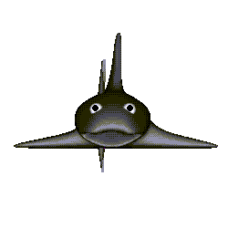<br><b>Sharky</b><br><code>sharky-15</code><br><sub>agent, Microsoft Agent 1.5 (third-party)</sub></td>
<td align="center" valign="bottom">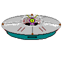<br><b>Spaceman</b><br><code>spaceman-15</code><br><sub>agent, Microsoft Agent 1.5 (third-party)</sub></td>
<td align="center" valign="bottom">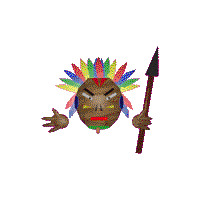<br><b>Totem</b><br><code>totem-15</code><br><sub>agent, Microsoft Agent 1.5 (third-party)</sub></td>
</tr>
<tr>
<td align="center" valign="bottom">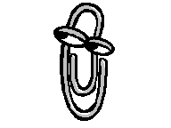<br><b>Clippit</b><br><code>clippit-97</code><br><sub>office97, Office 97</sub></td>
<td align="center" valign="bottom">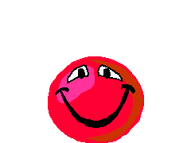<br><b>The Dot</b><br><code>dot-97</code><br><sub>office97, Office 97</sub></td>
<td align="center" valign="bottom">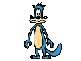<br><b>Earl</b><br><code>earl-97</code><br><sub>office97, Office 97</sub></td>
<td align="center" valign="bottom">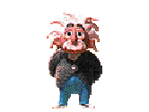<br><b>The Genius</b><br><code>genius-97</code><br><sub>office97, Office 97</sub></td>
<td align="center" valign="bottom">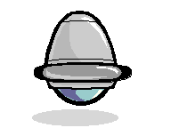<br><b>Hoverbot</b><br><code>hoverbot-97</code><br><sub>office97, Office 97</sub></td>
</tr>
<tr>
<td align="center" valign="bottom">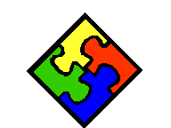<br><b>Office Logo</b><br><code>logo-97</code><br><sub>office97, Office 97</sub></td>
<td align="center" valign="bottom">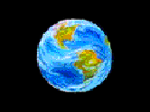<br><b>Mother Nature</b><br><code>mnature-97</code><br><sub>office97, Office 97</sub></td>
<td align="center" valign="bottom">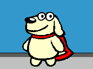<br><b>Power Pup</b><br><code>powerpup-97</code><br><sub>office97, Office 97</sub></td>
<td align="center" valign="bottom">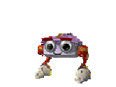<br><b>F1</b><br><code>robot-97</code><br><sub>office97, Office 97</sub></td>
<td align="center" valign="bottom"><br><b>Rocky</b><br><code>rocky-97</code><br><sub>office97, Office 97</sub></td>
</tr>
<tr>
<td align="center" valign="bottom">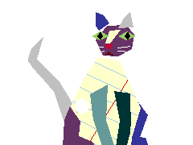<br><b>Scribble</b><br><code>scribble-97</code><br><sub>office97, Office 97</sub></td>
<td align="center" valign="bottom">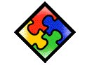<br><b>Office Logo</b><br><code>tofflogo-97</code><br><sub>office97, Office 97</sub></td>
<td align="center" valign="bottom">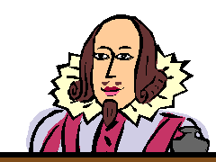<br><b>Will</b><br><code>will-97</code><br><sub>office97, Office 97</sub></td>
<td align="center" valign="bottom">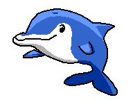<br><b>Kairu</b><br><code>dolphin-97</code><br><sub>office97, Office 97 (Japanese)</sub></td>
<td align="center" valign="bottom">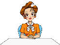<br><b>Saeko-sensei</b><br><code>offlady-97</code><br><sub>office97, Office 97 (Japanese)</sub></td>
</tr>
<tr>
<td align="center" valign="bottom">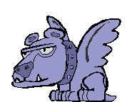<br><b>Baudelaire</b><br><code>baud-bob</code><br><sub>office97, Microsoft Bob</sub></td>
<td align="center" valign="bottom">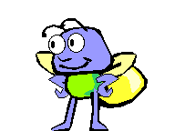<br><b>Blythe</b><br><code>blythe-bob</code><br><sub>office97, Microsoft Bob</sub></td>
<td align="center" valign="bottom">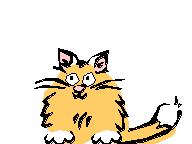<br><b>Chaos</b><br><code>chaos-bob</code><br><sub>office97, Microsoft Bob</sub></td>
<td align="center" valign="bottom">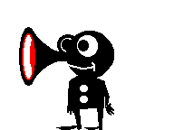<br><b>Chaz</b><br><code>chaz-bob</code><br><sub>office97, Microsoft Bob</sub></td>
<td align="center" valign="bottom">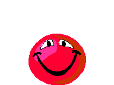<br><b>The Dot</b><br><code>dot-bob</code><br><sub>office97, Microsoft Bob</sub></td>
</tr>
<tr>
<td align="center" valign="bottom">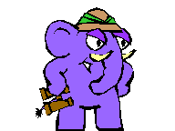<br><b>Hank</b><br><code>hank-bob</code><br><sub>office97, Microsoft Bob</sub></td>
<td align="center" valign="bottom">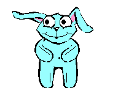<br><b>Hopper</b><br><code>hopper-bob</code><br><sub>office97, Microsoft Bob</sub></td>
<td align="center" valign="bottom">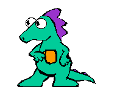<br><b>Java</b><br><code>java-bob</code><br><sub>office97, Microsoft Bob</sub></td>
<td align="center" valign="bottom">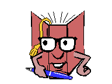<br><b>Lexi</b><br><code>lexx-bob</code><br><sub>office97, Microsoft Bob</sub></td>
<td align="center" valign="bottom">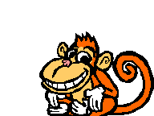<br><b>Lucy</b><br><code>lucy-bob</code><br><sub>office97, Microsoft Bob</sub></td>
</tr>
<tr>
<td align="center" valign="bottom">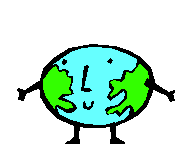<br><b>Orby</b><br><code>orby-bob</code><br><sub>office97, Microsoft Bob</sub></td>
<td align="center" valign="bottom">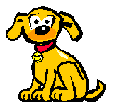<br><b>Rover</b><br><code>rover-bob</code><br><sub>office97, Microsoft Bob</sub></td>
<td align="center" valign="bottom">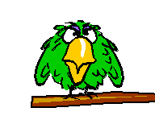<br><b>Ruby</b><br><code>ruby-bob</code><br><sub>office97, Microsoft Bob</sub></td>
<td align="center" valign="bottom">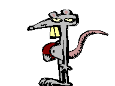<br><b>Scuzz</b><br><code>scuzz-bob</code><br><sub>office97, Microsoft Bob</sub></td>
<td align="center" valign="bottom">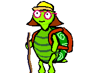<br><b>Shelly</b><br><code>shelly-bob</code><br><sub>office97, Microsoft Bob</sub></td>
</tr>
<tr>
<td align="center" valign="bottom"><br><b>William</b><br><code>will-bob</code><br><sub>office97, Microsoft Bob</sub></td>
<td align="center" valign="bottom"><br><b>Digger</b><br><code>worm-bob</code><br><sub>office97, Microsoft Bob</sub></td>
<td align="center" valign="bottom"><br><b>Speaker</b><br><code>zspeaker-bob</code><br><sub>office97, Microsoft Bob</sub></td>
<td align="center" valign="bottom"><br><b>Rover</b><br><code>rocky-greetings-act</code><br><sub>office97, Greetings Workshop</sub></td>
<td align="center" valign="bottom"><br><b>Rover</b><br><code>rocky-earlygreetings-act</code><br><sub>office97, Greetings Workshop</sub></td>
</tr>
<tr>
<td align="center" valign="bottom"><br><b>(unnamed)</b><br><code>tutor-act</code><br><sub>office97, My Personal Tutor</sub></td>
</tr>
</table>

## Licence

bentwire grants no licence for these files. The characters, their sounds and the balloon
art belong to Microsoft and, for nine of the Agent 1.5 characters, to third parties; they
are kept in this repository, apart from bentwire's code, so that the code repository never
contains this material. bentwire's `docs/sources.md` lists the product, version, size and
SHA-256 of every source file.

Built with AI assistance. Contains no AI.

## Characters

61 characters. Ids follow A-ID-1 of bentwire's `docs/architecture.md`: the file stem
for Agent 2.0, `-15` for Agent 1.5, `-97` for Office 97 actors, `-bob` for Microsoft Bob
actors, `-act` for other actors. `clippit` is the default.

[CONTENTS.md](CONTENTS.md) lists the source file of every id and every excluded source.

### Not included

A source goes in only when it converts completely (A-PACK-2).

- **The four Agent 2.0 web characters** Genie, Merlin, Peedy and Robby (ACF + ACA): many of
  their animation files are missing, and the complete `.acs` files of all four are in the
  pack.
- **ZVISIBLE.ACT** (Microsoft Bob): a helper actor that draws nothing in any frame
  (A-PACK-3).

Byte-identical copies of a source are skipped as duplicates.

<details>
<summary>Size</summary>

The pack is about 81 MB. Vector actors carry a 2x HiDPI sheet next to the 1x sheet, so they
are the one case larger than their source: Office 97 Clippit is 361 kB (1x) plus 954 kB
(2x) against a 468 kB `.ACT`; Will (Bob and Office 97) is about 6 times its `.ACT`. Bitmap
and Agent characters are smaller than their sources.

</details>

## Install

```sh
git clone https://github.com/mschabhuettl/bentwire-classics ~/.local/share/bentwire/characters/classics
```

Restart `bentwired` to pick it up; `bentwire characters` lists the ids.

## Regenerate

The pack is rebuilt from the original files. They are not part of this repository; bring
your own copies:

```sh
BENTWIRE_SOURCES=<dir>[:<dir>...] BENTWIRE_BIN=<dir with bentwire-convert> ./regenerate.sh
```

- `BENTWIRE_SOURCES`: one or more directories, separated by `:`, with your own copies of
  the original files, in any layout. `sources.sh` names every file it needs; each is found
  by its file name anywhere under these directories and verified by SHA-256. The files are
  only read.
- `BENTWIRE_BIN`: the directory with bentwire's `bentwire-convert`
  (`cargo build --release -p bentwire-convert` in bentwire gives `target/release`).
  Without it, `bentwire-convert` is taken from `PATH`.

The script converts every source into `<id>.bwc` (per-id options in `options.txt`), reads
the Office palette for bitmap actors from `MSO97.DLL` (Office 97), rasterises vector actors
with bentwire's WMF rasteriser (1x and 2x, aliased), extracts the balloon theme from
`OBALLOON.DLL` 10.0.2607 (Office XP), and writes `pack.toml` and `CONTENTS.md`. The output
is byte-identical on every run. Each `.bwc` names its source file and its SHA-256 prefix in
`[source]`.

## Screenshots and GIFs

bentwire with these characters on a real KDE Plasma 6 desktop (default Breeze look, with the
bentwire tray icon in the panel).

<table>
<tr>
<td align="center"><br><code>say</code>: the Agent word balloon types out the text</td>
<td align="center"><br><code>ask</code>: the Office balloon, and a click on a button</td>
</tr>
<tr>
<td align="center"><br>The right-click menu</td>
<td align="center"><br>Dragging the character across the desktop</td>
</tr>
<tr>
<td align="center"><br>Appearing and waving</td>
<td align="center"><br>A tour: Clippit, Merlin, Genie, Peedy, Rover</td>
</tr>
</table>

| File | Shows |
|---|---|
| [hero.gif](screenshots/hero.gif) | Clippit appears, waves and says hello |
| [appear.gif](screenshots/appear.gif) | the character appears and waves |
| [say.gif](screenshots/say.gif) | `bentwire say` with the Agent balloon typing out its text |
| [ask.gif](screenshots/ask.gif) | `bentwire ask` with the Office balloon; the pointer clicks "Show log" |
| [menu.gif](screenshots/menu.gif) | the right-click menu, the pointer moving over its items |
| [drag.gif](screenshots/drag.gif) | dragging the character across the desktop |
| [tour.gif](screenshots/tour.gif) | Clippit, Merlin, Genie, Peedy and Rover appear and greet one after another |
| [idle.png](screenshots/idle.png) | the whole Plasma desktop with the character above the panel and its tray icon |
| [say.png](screenshots/say.png) | `say` in the Agent word balloon |
| [ask.png](screenshots/ask.png) | `ask` in the Office balloon with the Office theme |
| [menu-en.png](screenshots/menu-en.png), [menu-de.png](screenshots/menu-de.png) | the right-click menu, English and German |
| [characters.png](screenshots/characters.png) | Agent 2.0 Merlin, Agent 1.5 Merlin, Office 97 Genius (bitmap) and Office 97 Clippit (vector), each from its own run on the same desktop |
| [hidpi.png](screenshots/hidpi.png) | the same desktop at output scale 2 (1600x900) |

Every GIF is recorded at output scale 2 and shows a 640x360 crop of the bottom right of the
desktop (1280x720 pixels, sharp, not upscaled), with the panel, the tray icon and the
clock. They are made by bentwire's `scripts/screenshots.sh --classics <this checkout> --all`,
on a headless Plasma session with a fixed 1280x720 output, seed 1 and a frozen clock. The
PNGs are byte-identical on every run. The GIFs are recorded in real time: some come out
byte-identical, the others with the same frames, except that a single frame time can
differ by 50 ms or one run has an extra short frame. The script sets `balloon_font = "Tahoma"`, so the word balloons show
Tahoma; without that setting they use fontconfig's fallback, see bentwire's README.

The images show KDE artwork: the wallpaper "Sub-Arctic" by Krystian Zajdel,
[CC BY-SA 4.0](https://creativecommons.org/licenses/by-sa/4.0/), and the Breeze theme,
icons and cursors of the KDE community. Details in bentwire's
[docs/credits.md](https://github.com/mschabhuettl/bentwire/blob/main/docs/credits.md).
