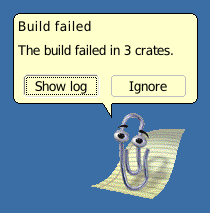

# bentwire-classics



The `classics` character pack for [bentwire](https://github.com/mschabhuettl/bentwire):
Microsoft Agent and Office Assistant characters converted into the bentwire character
format, plus the Office XP balloon theme (`balloon-themes/office`, from `OBALLOON.DLL`
10.0.2607). Everything here is generated by `regenerate.sh` from the original files.

Requires bentwire 0.1.0 or later.

## Licence

bentwire grants no licence for these files. The characters, their sounds and the balloon
art belong to Microsoft and, for eight of the Agent 1.5 characters, to third parties; they
are kept in this repository, apart from bentwire's code, so that the code repository never
contains this material. Where each source file came from is listed in bentwire's
`docs/sources.md`.

## Characters

57 characters. Ids follow A-ID-1 of bentwire's `docs/architecture.md`: the file stem for
Agent 2.0, `-15` for Agent 1.5, `-97` for Office 97 actors, `-bob` for Microsoft Bob actors,
`-act` for other actors.

| Origin | Ids |
|---|---|
| Agent 2.0 (ACS) | `clippit` (the default), `dot`, `f1`, `logo`, `mnature`, `offcat`, `rocky`, `courtney`, `earl`, `merlin`, `qmark`, `rover` |
| Agent 1.5 | `merlin-15`, `al-15`, `check-15`, `gourdy-15`, `max-15`, `miku-15`, `sharky-15`, `spaceman-15`, `totem-15` |
| Office 97 actors (ACT) | `clippit-97`, `dolphin-97`, `dot-97`, `earl-97`, `genius-97`, `hoverbot-97`, `logo-97`, `mnature-97`, `offlady-97`, `powerpup-97`, `robot-97`, `rocky-97`, `scribble-97`, `tofflogo-97`, `will-97` |
| Microsoft Bob actors (ACT) | `baud-bob`, `blythe-bob`, `chaos-bob`, `chaz-bob`, `dot-bob`, `hank-bob`, `hopper-bob`, `java-bob`, `lexx-bob`, `lucy-bob`, `orby-bob`, `rover-bob`, `ruby-bob`, `scuzz-bob`, `shelly-bob`, `will-bob`, `worm-bob`, `zspeaker-bob` |
| Other actors (ACT) | `rocky-greetings-act`, `rocky-earlygreetings-act`, `tutor-act` |

[CONTENTS.md](CONTENTS.md) lists the source file of every id and every excluded source.
bentwire's `docs/sources.md` gives version, size, SHA-256 and origin of every source file.

### Not included

A source goes in only when it converts completely, with no missing animation (A-PACK-2).

- **The four Agent 2.0 web characters** Genie, Merlin, Peedy and Robby (ACF + ACA): 216 of
  their animation files (Genie 64, Merlin 28, Peedy 72, Robby 52) were never archived.
- **Ozzar** (Agent 1.5): two of its animation streams are damaged.
- **ZVISIBLE.ACT**: a helper actor that draws nothing in any frame (A-PACK-3).

Byte-identical copies of a source (the Office 97 CD actors, the second Genie download) are
skipped as duplicates.

### Size

The pack is about 74 MB. Vector actors carry a 2x HiDPI sheet next to the 1x sheet, so they
are the one case larger than their source: Office 97 Clippit is 361 kB (1x) plus 954 kB
(2x) against a 468 kB `.ACT`; Will (Bob and Office 97) is about 6 times its `.ACT`. Bitmap
and Agent characters are smaller than their sources.

## Install

```sh
git clone https://github.com/mschabhuettl/bentwire-classics ~/.local/share/bentwire/characters/classics
```

Restart `bentwired` to pick it up; `bentwire characters` lists the ids.

## Regenerate

The pack is rebuilt from the original files. They are not public; the two directories are
given by environment variables:

```sh
BENTWIRE_REFERENCE=<research tree> BENTWIRE_SOURCES=<the owner's files> \
  BENTWIRE_BIN=<dir with bentwire-convert> ./regenerate.sh
```

- `BENTWIRE_REFERENCE` and `BENTWIRE_SOURCES`: the source files, only read. `sources.sh`
  prints the list of candidate sources, in build order.
- `BENTWIRE_BIN`: the directory with bentwire's `bentwire-convert`
  (`cargo build --release -p bentwire-convert` in bentwire gives `target/release`).
  Without it, `bentwire-convert` is taken from `PATH`.

The script converts every source into `<id>.bwc` (per-id options in `options.txt`), reads
the Office palette for bitmap actors from `MSO97.DLL` 8.0.3507 of the Office 97 CD,
rasterises vector actors with bentwire's WMF rasteriser (1x and 2x, aliased), extracts the
balloon theme from `OBALLOON.DLL`, and writes `pack.toml` and `CONTENTS.md`. The output is
byte-identical on every run. Each `.bwc` names its source file and its SHA-256 prefix in
`[source]`.

## Screenshots

| File | Shows |
|---|---|
| [idle.png](screenshots/idle.png) | Clippit idle |
| [say.png](screenshots/say.png) | `say` in the Agent word balloon |
| [ask.png](screenshots/ask.png) | `ask` in the Office balloon with the Office theme |
| [menu-en.png](screenshots/menu-en.png) | the right-click menu, English |
| [menu-de.png](screenshots/menu-de.png) | the right-click menu, German |
| [characters.png](screenshots/characters.png) | Agent 2.0 Merlin, Agent 1.5 Merlin, Office 97 Genius (bitmap), Office 97 Clippit (vector) |
| [hidpi.png](screenshots/hidpi.png) | Office 97 Clippit with the word balloon on a 2x output |

They are made by `scripts/screenshots.sh --classics <this checkout>` in bentwire, under
headless sway with a fixed output size and seed, and are reproducible.
